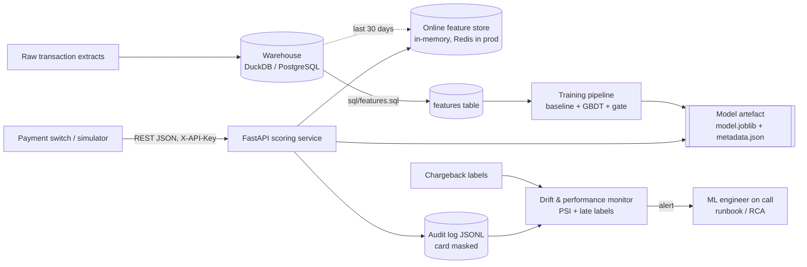

# Solution Design Document: Real-time Transaction Fraud Scoring

| | |
|---|---|
| Document ID | SDD-FRAUD-001 |
| Version | 1.0 |
| Status | Draft for review |
| Related | [Data mapping](data_mapping.md) · [Model card](model_card.md) · [Test plan](test_plan.md) · [Runbook](runbook.md) · [RCA-001](rca/RCA-001-card-testing-drift.md) |

## 1. Background and objective

Card fraud is caught today by static rules (for example "block if amount > X overseas"). Rules miss new patterns and
create many false alerts. The objective is a machine-learning scoring service that the card payment switch calls for
every authorisation, returning a risk score, a decision and the reasons behind it, within the authorisation time budget.

**Success criteria**

| # | Criterion | Target | Achieved (reference run, synthetic data) |
|---|---|---|---|
| 1 | Fraud recall at analyst capacity (1% of traffic reviewed) | >= 85% | 92.4% (test period) |
| 2 | Better than the rule-like linear baseline | PR-AUC above baseline | 0.893 vs 0.412 |
| 3 | Scoring latency | p95 < 100 ms | ~12 ms server-side, ~13 ms end-to-end (single worker) |
| 4 | Every alert explainable to an analyst | 1-3 reason codes | Yes (UAT-03) |
| 5 | No full card number in any log | 0 occurrences | Yes (SIT-05) |

## 2. Scope

In scope: feature engineering, model training and quality gate, scoring API, audit logging, drift and performance
monitoring, CI/CD, documentation.
Out of scope (future phases): case-management UI for analysts, Redis/Kafka production integration, champion/challenger
traffic splitting, customer notification (SMS step-up).

## 3. Architecture



### Components

| Component | Code | Responsibility |
|---|---|---|
| Data generator | `src/fraud/data/generate.py` | Synthetic transactions in the public Kaggle/Sparkov schema |
| Feature build | `sql/features.sql`, `src/fraud/features/build.py` | Point-in-time features, portable SQL |
| Online features | `src/fraud/features/online.py` | Same features in real time; parity proven by a test |
| Training | `src/fraud/training/train.py` | Time split, baseline vs candidate, thresholds, gate, artefacts |
| Reason codes | `src/fraud/training/explain.py` | Model-agnostic "what pushed the score up" |
| Scoring API | `src/fraud/service/app.py` | Validation, auth, scoring, decision, audit log |
| Monitoring | `src/fraud/monitoring/drift.py` | PSI drift + label-based performance tracking |
| CI/CD | `.github/workflows/ci.yml` | Lint, tests, train + gate, image build, smoke test, deploy |

## 4. Interface contract

`POST /v1/score` with header `X-API-Key`. Full OpenAPI at `/docs` when the service is running.

Request (all fields required, validated):

| Field | Type | Rule |
|---|---|---|
| trans_num | string | 1-64 chars, unique id from the switch |
| trans_date_trans_time | datetime | ISO-8601; timezone-aware values are converted to UTC |
| cc_num | string | 12-19 digits (PAN); never logged in full |
| merchant, category | string | category outside the training set is accepted and treated as "unknown" |
| amt | number | > 0 and < 1,000,000 |
| lat, long, merch_lat, merch_long | number | valid coordinates |
| city_pop | integer | >= 0 |
| dob | date | used only to derive age; never logged |

Response:

```json
{
  "trans_num": "T000000001",
  "score": 0.8731,
  "decision": "DECLINE",
  "reasons": [
    {"feature": "distance_km", "value": 10512.4, "impact": 0.61, "description": "Distance between cardholder home and merchant (km)"}
  ],
  "model_version": "hgb-20261112T081747Z",
  "latency_ms": 9.8
}
```

Errors: `401` missing or wrong key, `422` validation failure (field-level detail returned), `5xx` the switch falls back
to its existing rule engine (fail-open for availability, see section 6).

## 5. Decision policy

Thresholds are set on the validation period, not by hand, and stored with the model:

- **REVIEW** when the score is in the top 1% of traffic (analyst capacity, `ALERT_BUDGET`).
- **DECLINE** when the validation precision at that score is >= 90% (`DECLINE_MIN_PRECISION`).
- **APPROVE** otherwise.

Changing the policy is a configuration change in `src/fraud/config.py` followed by a retrain, so it goes through the
same review and quality gate as a model change.

## 6. Non-functional requirements

| Area | Requirement | Design |
|---|---|---|
| Latency | p95 < 100 ms | In-process model, O(card history) features; measured 12 ms p95 |
| Availability | Scoring outage must not stop payments | Switch times out at 150 ms and falls back to rules; health check + restart policy |
| Security | Authenticated callers only; secrets out of code | API key from secret manager (env var), constant-time compare; non-root container |
| Data protection | PDPA / MAS TRM: minimise personal data | PAN masked to last 4 digits, DOB and home location never logged, gender not used as a feature |
| Auditability | Reconstruct any decision | Audit log holds model version, score, decision, reasons and the exact feature values |
| Reproducibility | Same input gives the same model | Pinned dependencies, fixed seeds, time-based split, artefacts versioned by timestamp |
| Scalability | Horizontal scaling | Move card history to Redis, then run N workers/replicas behind a load balancer |

## 7. Key design decisions

| Decision | Alternatives | Why |
|---|---|---|
| Time-based train/valid/test split | Random split | Random split leaks future fraud behaviour and overstates performance |
| PR-AUC and recall at 1% alert rate | Accuracy, ROC-AUC | Fraud is ~0.4% of traffic; accuracy is meaningless and ROC-AUC looks great even for weak models |
| One feature definition in SQL + a parity test for the online code | Separate logic per path | Training/serving skew is a top cause of silent model failure |
| Category as a native categorical feature | Target encoding of fraud rate | Fraud labels arrive weeks late; naive target encoding leaks the label |
| Gradient-boosted trees (HistGradientBoosting; XGBoost optional) | Deep learning | Tabular data, fast inference, strong baseline, easy to explain |
| Monitor labels as well as PSI | PSI only | RCA-001: recall fell from 92% to 22% while every PSI stayed "OK" |

## 8. Risks and mitigations

| Risk | Mitigation |
|---|---|
| Fraudsters change tactics (concept drift) | Weekly label-based recall monitoring, retraining procedure, RCA-001 |
| In-memory card history lost on restart | Startup hydration from the warehouse (`FEATURE_BOOTSTRAP_CSV`); Redis in production |
| Model bias against customer groups | Gender excluded; recall per age band reviewed in the model card before release |
| Over-blocking genuine customers | Auto-decline only at >= 90% precision; everything else goes to human review |
